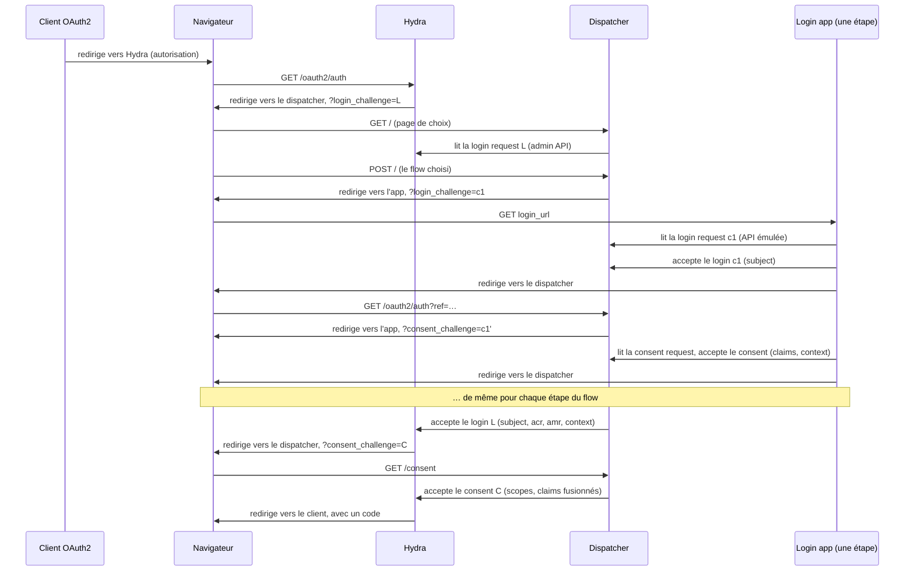

# Comprendre le dispatcher

Ce document explique à quoi sert le dispatcher et comment une connexion le traverse, pour qui développe une login app, intègre le dispatcher ou arrive sur le projet. Il ne dit pas comment le déployer (`livrer.md`), le configurer (`configurer.md`) ou l'exploiter (`exploiter.md`). Les mots en *italique* sont définis dans le glossaire, à la fin.

## À quoi il sert

[Ory Hydra](https://www.ory.sh/hydra/) est un serveur OAuth2 et OpenID Connect : il délivre les jetons aux applications clientes, mais n'authentifie personne lui-même. Il délègue la connexion à **une seule** *login app*, par trois URL de sa configuration (`urls.login`, `urls.consent`, `urls.logout`) et une API d'administration.

Le dispatcher occupe cette place unique, et la démultiplie : il fait choisir à l'usager un mode de connexion, un *flow*, puis enchaîne ses *étapes*, chacune confiée à une vraie login app (un mot de passe, puis un code par courriel, puis l'acceptation d'une charte, par exemple). Vu de Hydra, le dispatcher est la login app ; vu des login apps, il est Hydra : il leur sert le même protocole, sur une API qui imite celle de Hydra, l'*API émulée*. Les login apps écrites pour Hydra fonctionnent donc derrière lui sans modification.

Il remplace le dispatcher Symfony (`Cadoles/hydra-dispatcher`) en gardant ses contrats : les URL que Hydra appelle, l'API émulée, le format de la configuration et l'API d'administration `/admin/v1`.

## Flows, apps, étapes

- Une **app** est une login app déclarée au dispatcher : son `login_url`, son `consent_url`, son `logout_url` si elle en a une, sa *méthode* (la valeur d'*amr* qu'elle apporte, `pwd`, `otp`…), et ce qui l'identifie quand elle appelle l'API émulée (ses adresses réseau).
- Un **flow** est une suite ordonnée d'étapes, avec un titre, une description et une icône dans chaque langue, affichés sur la page de choix ; il peut déclarer son *acr*.
- Une **étape** est une app à une position dans un flow. Elle peut exiger que le *subject* qu'elle accepte soit celui de la première étape (`subject_check: equal`), ou la valeur d'un claim d'une étape précédente (`claim:email`) : la règle posée, une étape ne peut pas authentifier quelqu'un d'autre que celui que la première a reconnu. Par défaut, il n'y en a aucune (`none`). Le subject final est toujours celui de la première étape.

La même app peut servir dans plusieurs flows. Par exemple, le flow `sql-2fa` enchaîne `sql` (le mot de passe), `2fa` (un code par courriel) et `charter` (la charte) ; le flow `france-connect` enchaîne `france-connect` et `charter`.

## Une connexion de bout en bout

1. Le client envoie le navigateur chez Hydra. Hydra crée une *login request* et renvoie le navigateur vers son URL de login, le dispatcher, avec son *challenge*.
2. Le dispatcher lit la login request (sur l'admin de Hydra, ou en la déchiffrant lui-même avec Hydra 2.2), crée l'état de la connexion, et affiche la **page de choix** : les flows que ce client peut utiliser.
3. L'usager choisit. Le dispatcher envoie le navigateur vers la première app, avec un challenge à lui, propre à cette étape : jamais celui de Hydra.
4. L'app joue son protocole habituel, contre l'API émulée : elle lit la login request, authentifie l'usager, accepte le login ; puis, de retour par le dispatcher, elle lit la consent request et accepte le consent, avec les claims qu'elle fournit (une adresse, un nom…).
5. Le dispatcher passe à l'étape suivante. Il donne à chaque app les claims `id_token` des étapes précédentes (`x_dispatcher_claims`), filtrés par ce qu'elle déclare recevoir (`receive_claims` ; tous si l'app n'en déclare pas) : c'est ainsi que l'app du second facteur connaît l'adresse à qui envoyer le code.
6. Toutes les étapes faites, le dispatcher accepte le login auprès de Hydra : le subject de la première étape, l'acr du flow, l'amr (la méthode de chaque étape), et le *contexte* que chaque étape a donné à son accept de consent, fusionné (le dernier gagnant). Le *webhook* de login, s'il est configuré, passe juste avant.
7. Hydra renvoie vers l'URL de consent, le dispatcher. Il accepte le consent avec les scopes demandés et les claims des étapes fusionnés (le dernier gagnant ; un `null` n'efface rien), après le webhook de consent ; ou il affiche d'abord un écran de consentement, selon la configuration et le client. Avec `consent.claims_filter: strict`, un claim qu'aucun scope accordé ne couvre n'est pas envoyé.
8. Hydra délivre le code au client, qui l'échange contre ses jetons.

L'usager peut revenir au choix à tout moment : une app peut afficher le lien que le dispatcher lui donne (`x_dispatcher_restart_url`), sauf quand le flow est imposé.

### Ce qu'une login app doit faire

Une app qui marche derrière Hydra marche derrière le dispatcher, à quelques points près :

- son URL d'admin de Hydra pointe sur le dispatcher (chemins v2 `/admin/oauth2/auth/requests/…`, ou v1 sans `/admin`) ;
- le challenge arrive dans la query (`login_challenge`, `consent_challenge`, `logout_challenge`) ; elle lit la demande, l'accepte ou la rejette, et envoie le navigateur vers le `redirect_to` de la réponse ;
- `skip` vaut toujours `false` : le dispatcher a déjà traité le skip de Hydra ; après la première étape, `subject` est déjà rempli, avec celui de la première ;
- un appel rejoué (un double envoi, un retour du navigateur) reçoit le même `redirect_to`, en 200 sur un accept, en 410 sur une lecture : à suivre comme une réponse normale ;
- elle trouve les claims des étapes précédentes dans `x_dispatcher_claims`, et met les siens dans le `session.id_token` de son accept de consent ;
- le `context` de son accept de login ne revient qu'à elle, dans sa consent request ; celui de son accept de consent part chez Hydra, fusionné avec ceux des autres étapes ;
- si elle déclare un `logout_url`, elle y reçoit un `logout_challenge` à la déconnexion : elle lit la demande, l'accepte, et suit le `redirect_to`.

### Le choix du flow

La page de choix n'offre que les flows activés que le client peut utiliser :

- un client peut être restreint à certains flows (`metadata.dispatcher.flows` du client Hydra) ; s'il n'en reste aucun, le login est rejeté ;
- un client qui demande un niveau (`acr_values`) ne se voit offrir que les flows dont l'acr y figure, s'il y en a. Si aucun flow ne le déclare, tous restent offerts, et l'acr envoyé dit ce qui a été fait : OpenID Connect fait des `acr_values` une demande, pas une exigence, et c'est au client de juger. Le réglage `acr_values_mode: require` rejette alors le login (`unmet_authentication_requirements`) ;
- un client peut désigner un flow par la valeur `urn:hydra-dispatcher:preferred-app:<id du flow>` dans ses `acr_values` : ce flow est alors *imposé*, sans page, s'il fait partie des flows offerts ;
- un seul flow possible est choisi d'office si `app_auto_select` est vrai ; il est imposé si c'est la restriction du client qui ne laisse que lui ;
- le dernier flow choisi dans ce navigateur peut être présélectionné.

La page, le consent, la confirmation de déconnexion et les erreurs sont les seules pages du dispatcher. Elles sont dans la langue de l'usager (le `ui_locales` du client, ou le choix fait sur la page) et peuvent porter un thème (voir `themes.md`).

## L'API émulée

C'est l'API d'administration de Hydra, telle que les login apps l'appellent : lire, accepter ou rejeter une login request, une consent request, une logout request. Elle est servie sous les chemins de Hydra v2 (`/admin/oauth2/auth/requests/…`) et sous ceux de Hydra v1, sans `/admin`, que le dispatcher Symfony servait (dépréciés, gardés pour la migration). Ses réponses ont la forme de celles de Hydra, avec quelques membres de plus, préfixés `x_dispatcher_` (les claims des étapes précédentes, le lien de retour au choix, la valeur de l'appareil de la vérification préalable).

Seules les apps déclarées y ont accès, chacune pour ses propres étapes : le dispatcher les reconnaît à leur adresse réseau. (Un mode par certificat client, `auth_mode: mtls`, existe dans la configuration mais n'est pas encore servi : le dispatcher ne sert pas de TLS, et refuse tous les appels d'une app ainsi déclarée.) Une app ne voit jamais le challenge de Hydra, seulement ceux que le dispatcher lui émet.

## Ce que le dispatcher retient

- **La configuration** (apps, flows, réglages, clients de l'API, comptes de l'admin, catalogue des scopes) vit dans une base **Postgres**. Le fichier `dispatcher.yaml` décrit l'infrastructure et une *graine* : la configuration initiale, que `bootstrap` écrit en base. Ensuite, l'admin la modifie en base : l'instance qui écrit l'applique aussitôt, les autres la relisent dans la minute.
- **Les connexions en cours** vivent dans un store d'état : **Redis** (ou Dragonfly), ou la mémoire pour une instance seule. Une connexion y tient une clé, le temps du parcours.
- **Le navigateur** porte quelques cookies : scellés, la *mémoire du skip* et l'appareil de la vérification préalable quand elle est active ; en clair, la protection CSRF du parcours, la langue et le dernier flow choisi.

Les instances sont donc interchangeables : on en met autant que la charge le demande, derrière un répartiteur, sans affinité de session.

## Le skip

Une fois connecté, l'usager garde une session chez Hydra. À la connexion suivante, pour un autre client ou le même, Hydra le signale (`skip`) : il n'y a rien à redemander. Le dispatcher accepte alors directement, sans page de choix ni app (l'écran de consentement peut s'afficher, selon la configuration et le client), en reprenant ce que la connexion précédente avait accepté : il le garde, chiffré, dans le cookie `dispatcher_remember`. Si ce cookie manque, ou ne correspond plus (une autre session, un flow changé, d'autres scopes), il refait le parcours, et vérifie à la fin que c'est bien le même subject que Hydra connaît.

## La déconnexion

Quand un client déconnecte l'usager, Hydra envoie le navigateur vers l'URL de logout, le dispatcher.

1. Si la demande ne vient pas d'un client qui prouve qui il est (`id_token_hint`), le dispatcher demande d'abord confirmation : un autre site ne peut pas déconnecter l'usager à son insu.
2. Il accepte la déconnexion auprès de Hydra, puis fait passer le navigateur par chaque app que la session a utilisée et qui déclare un `logout_url` : chacune reçoit un `logout_challenge`, le lit et l'accepte sur l'API émulée, ferme sa propre session et suit le `redirect_to`, qui la renvoie au dispatcher ; il passe à la suivante. Sans trace des apps de la session (la mémoire du skip absente), il passe par toutes celles qui ont un `logout_url`, ou par aucune, selon `logout.propagate_without_record` ; une app qui déclare `receive_claims` reçoit alors un subject et un `sid` vides.
3. Après la dernière, il renvoie le navigateur vers Hydra, qui termine la déconnexion et prévient les clients.

C'est au mieux : une app qui ne répond pas arrête la chaîne côté navigateur ; la session de Hydra est alors supprimée à la prochaine connexion dans ce navigateur.

## Les webhooks

Deux URL optionnelles, appelées juste avant d'accepter auprès de Hydra : à l'accept du login, et à l'accept du consent. Le webhook reçoit ce que le dispatcher va envoyer (le subject, l'acr, l'amr, le contexte ; les claims du consent) et peut le modifier. Les appels sont signés (`X-Dispatcher-Signature`, un HMAC par la clé `secrets.webhook_signing_key`). Un webhook en échec arrête la connexion sur une page d'erreur, que l'usager peut recharger. Un portail s'en sert par exemple pour compléter les claims avec ses propres données.

## La vérification préalable d'une étape

Une extension, désactivée par défaut. Avant une étape qui le demande (jamais la première), le dispatcher demande à son app, de serveur à serveur, si l'usager est déjà connu sur cet appareil ; si elle dit oui, l'étape est sautée. Le cas visé : un second facteur avec « se souvenir de cet appareil ».

- Le dispatcher pose dans le navigateur un cookie d'appareil, et donne à chaque app une valeur qui en est dérivée (`x_dispatcher_device`) : une app ne peut pas reconnaître l'appareil d'une autre.
- Après un second facteur réussi, l'app retient cette valeur pour l'usager, le temps qu'elle choisit.
- À la connexion suivante, le dispatcher lui demande, par un appel signé, si elle connaît ce couple ; elle répond par une réponse signée. Il ne demande pas si le client exige une authentification fraîche (`prompt=login`, `max_age`), ni si le client demande l'acr que le flow enverra (le sien, ou à défaut le nombre d'étapes plafonné à 2) sans que `skip_check_allowed_acr` l'admette. Toute erreur, tout délai dépassé (300 ms), fait jouer l'étape normalement.
- Le contexte de l'accept de login le dit : `x_dispatcher_skipped_steps` liste les apps des étapes sautées. Le webhook de login le reçoit. Ni le webhook de consent ni le client ne le voient, sauf si le webhook de login le recopie sous une autre clé du contexte, dont le webhook de consent peut faire un claim.

L'app de référence (`examples/skipcheck-app`) l'implémente ; le protocole est décrit dans son README.

## L'administration

- **Les écrans**, sous `/admin` : les apps, les flows et leurs étapes, les réglages, les clients Hydra, le catalogue des scopes, les clients de l'API, les comptes, le niveau des journaux. Deux rôles : `admin` (tout) et `viewer` (lecture). Connexion par mot de passe, ou par un fournisseur OpenID Connect.
- **L'API**, sous `/admin/v1`, la même que celle du dispatcher Symfony, décrite par sa spec OpenAPI (`api/openapi.yaml`) et consultable sous `/admin/v1/docs` : des clients authentifiés par leur secret obtiennent un jeton (`/admin/v1/token`), limité à leurs scopes (`admin:apps`, `admin:flows`…).
- **La ligne de commande** du binaire : `migrate`, `bootstrap`, `admin` (les comptes), `client` (les clients de l'API), `config dump|diff`, `secrets status|rekey`.

Toute modification est vérifiée avant d'être écrite (une étape sur une app qui n'existe pas, un flow sans étape sont refusés), et tracée au journal d'audit.

## Ce qui se voit

- `/health` (le processus répond) et `/ready` (l'instance sert ; 503 seulement pendant son arrêt) pour les sondes. L'état de Hydra, de la base et de Redis est dans la réponse de `/ready` et dans la métrique `hydra_dispatcher_ready_check_up`, sans changer son code : une panne commune ne retire pas toutes les instances à la fois.
- Des métriques Prometheus (`/metrics`), sur le port du service ou sur un port à part que l'ingress n'expose pas.
- Trois journaux JSON, distingués par `log_type` : le service, les accès, l'audit (connexions réussies ou échouées, déconnexions, changements de configuration).
- Des erreurs vers Sentry, des traces OpenTelemetry, si on les configure.
- Les pages d'erreur portent un code (`E1001` challenge invalide, `E1002` session absente ou expirée, `E1004` Hydra indisponible…) et l'identifiant de trace de la requête, qui mène à sa cause dans les journaux.

## Glossaire

| Terme | Sens |
| --- | --- |
| **acr** | le niveau d'authentification annoncé au client ; celui du flow, ou, à défaut, le nombre d'étapes faites, plafonné à 2 |
| **amr** | les méthodes d'authentification employées (`pwd`, `otp`…) ; la méthode de chaque app du flow, ou, avec `aggregate_amr_from_login_request`, l'amr que chaque app a envoyé |
| **API émulée** | l'API d'administration de Hydra, servie par le dispatcher aux login apps |
| **app** (login app) | une application qui authentifie l'usager pour une étape : un mot de passe, un code, un fournisseur externe |
| **challenge** | l'identifiant d'une demande en cours (login, consent, logout) ; celui de Hydra pour le dispatcher, ceux du dispatcher pour les apps |
| **claims** | les informations sur l'usager qui iront dans ses jetons (adresse, nom…), fournies par les apps à leur consent |
| **client** | l'application qui demande les jetons à Hydra (le portail, un service partenaire) |
| **contexte** (`context`) | un objet libre joint à un accept ; celui de l'accept de consent de chaque étape part chez Hydra, fusionné, et revient au webhook de consent ; celui de l'accept de login ne revient qu'à l'app elle-même |
| **consent** | la seconde phase d'une connexion OAuth2 : les droits (scopes) accordés au client, et les claims qu'il reçoit |
| **étape** | une app à sa position dans un flow |
| **flow** | un mode de connexion : une suite d'étapes, offerte sur la page de choix |
| **graine** | la configuration initiale décrite dans `dispatcher.yaml`, que `bootstrap` écrit en base |
| **login request** | la demande de connexion en cours, que Hydra (ou le dispatcher, pour une app) décrit et qu'on accepte ou rejette |
| **mémoire du skip** | le cookie `dispatcher_remember`, chiffré, qui permet d'accepter un skip sans refaire le parcours |
| **scope** | un droit que le client demande (`openid`, `email`…) ; le catalogue des scopes dit quels claims chacun couvre |
| **skip** | le signal de Hydra qu'une session existe déjà : rien à redemander |
| **subject** | l'identifiant de l'usager qui sera dans ses jetons ; celui que la première étape accepte |
| **webhook** | une URL appelée avant d'accepter auprès de Hydra, qui peut modifier ce qui sera envoyé |
